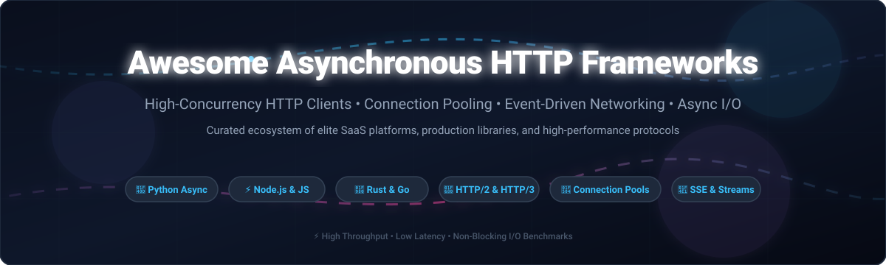

  

# 🚀 Awesome Asynchronous HTTP Frameworks

  
  
  
  
  
  
  

## 🌐 Top Asynchronous HTTP Frameworks Ecosystem

> **Curated List of Production-Grade SaaS Platforms & High-Performance Open-Source GitHub Projects**  
> *Focused on Async HTTP Clients, Connection Pooling, Non-Blocking Sockets & High-Concurrency Requests*  
> **Last updated: October 2026**

This repository tracks notable **SaaS platforms** and **open-source projects** for **Asynchronous HTTP Frameworks**. Modern software architectures demand efficient I/O at scale—from non-blocking network event loops and connection pooling to HTTP/2 multiplexing, HTTP/3 QUIC, Server-Sent Events (SSE), and streaming responses across Python, JavaScript/Node.js, Rust, Go, and Java.

**Key Examples**: Axios, Requests, OkHttp, cURL, HTTPie, FastHTTP, Ky, SuperAgent, Aiohttp, HTTPX, Got, Reqwest, Resty, Undici, and urllib3.

---

## 📑 Table of Contents

- [📊 Sector Overview & Market Dynamics](#-sector-overview--market-dynamics)
- [☁️ SaaS/Hosted Platforms](#️-saashosted-platforms)
- [💻 Open-Source GitHub Projects](#-open-source-github-projects)
- [🌟 Star History](#-star-history)
- [🤝 Support](#-support)
- [📝 How to Contribute](#-how-to-contribute)
- [⚠️ Disclaimer](#️-disclaimer)

---

## 📊 Sector Overview & Market Dynamics

The global API client, testing, and lifecycle management tooling market is estimated at approximately **$1.6B–$1.75B** (scaling beyond **$5B+ by 2030** at a **>20% CAGR**), nested within the broader **$9B+ enterprise API management** industry. The sector is moderately concentrated at the top with clear category heavyweights (such as Postman holding strong developer-first mindshare and Kong leading gateway/enterprise integrations), alongside a fragmented long tail of lightweight open-source and modular API developer tools competing on speed, local privacy, and open standards.

---

## ☁️ SaaS/Hosted Platforms

| Platform | Company Scale / Valuation | Pricing | Free Tier Limits | Description |
| :--- | :--- | :--- | :--- | :--- |
| **[Postman CLI](https://www.postman.com/)** | **$5.6B valuation** (~$100M+ ARR) | Free forever ($0); Solo paid plan starts at **$9/month** (billed annually) or **$14/month** (monthly); Team plan starts at **$19/user/month** | **1 user strictly**; Unlimited collection runs and mock servers; 1,000 monitoring requests/month; 50 AI Postbot credits/month | Command-line collection runner and API testing tool from the Postman platform. Features collection execution, environment management, and CI/CD integration. |
| **[Insomnia](https://insomnia.rest/)** | **$2.0B valuation** (Parent Kong Inc.; $100M+ ARR) | Essentials plan free forever ($0); Pro paid plan starts at **$12/user/month**; Enterprise plan at **$45/user/month** | **Up to 3 users for Git Sync**; Unlimited local/cloud projects; 1,000 mock server requests/month; Full Inso CLI and collection runs; Offline Scratch Pad mode | API client for GraphQL, REST, WebSockets, SSE, and gRPC. Features design-first spec editing, test suites, and MCP client support. |
| **[HTTPie Cloud](https://httpie.io/)** | **$3.5M seed funding** (~$550K estimated ARR) | Free forever preview / open-source; Enterprise & team custom quotation upon sales request | **Unlimited free forever usage for individual developer client**; Free unlimited terminal CLI (BSD licensed); Free web & desktop apps with local offline storage, cloud backup sync, and preview HTTPie AI features | Managed version and web/desktop GUI of the HTTPie client with syntax highlighting, JSON support, and cloud sync for API requests and environments. |

---

## 💻 Open-Source GitHub Projects

All open-source repositories below are sorted in descending order by GitHub Stars_Count:

1. **[Axios](https://github.com/axios/axios)**   
   **Promise-based HTTP client for the browser and Node.js** (MIT). The most widely used JavaScript HTTP library—features interceptors, automatic JSON transformation, timeouts, and request/response cancellation. The universal standard for JavaScript HTTP requests.

2. **[Requests](https://github.com/psf/requests)**   
   **The most widely used HTTP library for Python** (Apache-2.0). "HTTP for Humans" with a simple, intuitive API. Synchronous client with connection pooling via urllib3; the spiritual reference implementation for developer-friendly HTTP libraries worldwide.

3. **[OkHttp](https://github.com/square/okhttp)**   
   **Square’s meticulous HTTP & HTTP/2 client for Android and Java applications** (Apache-2.0). Features transparent HTTP/2 multiplexing, connection pooling to reduce request latency, transparent GZIP compression, and response caching.

4. **[cURL](https://github.com/curl/curl)**   
   **The universal command-line tool and libcurl library for transferring data with URLs** (curl License). Supports HTTP, HTTPS, HTTP/2, HTTP/3, WebSockets, and dozens of network protocols. The foundation of internet-scale network transfers.

5. **[HTTPie CLI](https://github.com/httpie/cli)**   
   **User-friendly command-line HTTP client for API testing** (BSD-3-Clause). Features built-in JSON support, syntax highlighting, persistent sessions, downloads like wget, and plugin extensions.

6. **[FastHTTP](https://github.com/valyala/fasthttp)**   
   **Fast HTTP package for Go tuned for high performance and zero memory allocations** (MIT). Up to 10x faster than `net/http` in high-concurrency benchmarks, handling 100k+ concurrent requests/sec with minimal memory footprint.

7. **[Ky](https://github.com/sindresorhus/ky)**   
   **Tiny and elegant HTTP client based on the browser Fetch API** (MIT). Features automatic retry with backoff, JSON convenience methods, timeout support, URL prefixing, and hooks. Designed for modern browsers, Service Workers, and Node.js.

8. **[SuperAgent](https://github.com/ladjs/superagent)**   
   **Small progressive client-side HTTP request library and Node.js module** (MIT). Featuring fluid method chaining, promise and async/await support, plugins, and streaming request handling.

9. **[Aiohttp](https://github.com/aio-libs/aiohttp)**   
   **Asynchronous HTTP client/server framework for asyncio and Python** (Apache-2.0). The foundational async HTTP library for Python—provides client session connection pooling, streaming responses, WebSocket client/server support, and non-blocking I/O.

10. **[HTTPX](https://github.com/encode/httpx)**   
    **Next-generation HTTP client for Python with standard sync and async APIs** (BSD-3-Clause). Features HTTP/2 support, strict timeouts, connection pooling, direct ASGI/WSGI app calling, and full type annotations. The modern choice for Python asyncio workflows.

11. **[Got](https://github.com/sindresorhus/got)**   
    **Human-friendly and powerful HTTP request library for Node.js** (MIT). Offers native HTTP/2 support, RFC-compliant caching, progressive retry logic, streams, and pagination helpers.

12. **[reqwest](https://github.com/seanmonstar/reqwest)**   
    **Ergonomic, batteries-included async HTTP client for Rust** (Apache-2.0/MIT). Built on Tokio and Hyper with connection pooling, TLS (native or rustls), streaming request/response bodies, JSON serialization, and WASM compilation support.

13. **[Resty](https://github.com/go-resty/resty)**   
    **Simple and ergonomic HTTP and REST client library for Go** (MIT). Provides request and response interceptors, automatic retries with backoff, circuit breaking support, request tracing, and seamless JSON/XML payload unmarshaling.

14. **[Undici](https://github.com/nodejs/undici)**   
    **High-performance HTTP/1.1 and HTTP/2 client written from scratch for Node.js** (MIT). Powers the global `fetch()` implementation in modern Node.js, delivering significantly higher throughput and lower overhead than legacy `http.Agent`.

15. **[curl-impersonate](https://github.com/lwthiker/curl-impersonate)**   
    **Special build of curl that impersonates major browser TLS fingerprints** (MIT). Mimics Chrome, Edge, Safari, and Firefox TLS Client Hello fingerprints (JA3/JA4) and HTTP/2 settings to prevent automated bot blocks during high-concurrency data scraping.

16. **[Nodriver](https://github.com/ultrafunkamsterdam/nodriver)**   
    **Successor to undetected-chromedriver** (MIT). Asynchronous browser orchestration with direct Chrome DevTools Protocol (CDP) communication, avoiding WebDriver detection signatures while allowing concurrent web fetching.

17. **[urllib3](https://github.com/urllib3/urllib3)**   
    **The battle-tested HTTP library with thread-safe connection pooling for Python** (MIT). Features client-side TLS verification, retry mechanisms, and streaming decode. Deployed in millions of production environments as the core transport for Requests.

18. **[Niquests](https://github.com/jawah/niquests)**   
    **Drop-in replacement for Requests with native async, HTTP/2, and HTTP/3 multiplexing** (Apache-2.0). Provides seamless async migration for legacy Requests codebases without altering fundamental method signatures.

19. **[ureq](https://github.com/algesten/ureq)**   
    **Minimalist, safe HTTP request library for Rust without heavy async runtimes** (Apache-2.0/MIT). Focused on small binary footprints, clean blocking APIs, and fast build times when an async event loop is unnecessary.

20. **[PyCurl](https://github.com/pycurl/pycurl)**   
    **Python interface to libcurl** (LGPL/MIT). Extremely fast C-extension bindings supporting multi-interface concurrent transfers, connection reuse, and fine-grained socket controls.

21. **[HTTPcore](https://github.com/encode/httpcore)**   
    **Low-level HTTP transport engine underlying HTTPX** (BSD-3-Clause). Provides connection pooling, HTTP/1.1 and HTTP/2 wire-level protocols, sync and async concurrency backends (asyncio and trio).

22. **[Unirest Python](https://github.com/Kong/unirest-python)**   
    **Simplified, lightweight HTTP client library** (MIT). Part of the Unirest suite offering uniform, declarative request syntax across multiple programming languages.

23. **[httpx-sse](https://github.com/florimondmanca/httpx-sse)**   
    **Server-Sent Events (SSE) streaming consumer for HTTPX** (MIT). Provides non-blocking parsing of event-stream responses, perfect for AI chat completions and real-time LLM token streaming.

24. **[rnet](https://github.com/levyvix/rnet)**   
    **High-performance Rust-powered HTTP client for Python** (MIT). Binds Rust’s native concurrency directly to Python for maximum throughput and minimal overhead during bulk network requests.

---

## 🌟 Star History

---

## 🤝 Support

Thank you for exploring this curated repository! If you find this guide helpful for building fast, resilient, and non-blocking network applications:

- ⭐ **Star this repository** to help other developers discover it!
- 🍴 **Fork it** and contribute your favorite async HTTP libraries and tools.
- 📣 **Share it** on social platforms, developer forums, and Discord communities.
- ☕ **Buy me a coffee / Sponsor**: If you'd like to support ongoing maintenance and new developer guides, visit my [GitHub Sponsors Dashboard](https://github.com/sponsors/ishandutta2007).

---

## 📝 How to Contribute

1. Fork this repository.
2. Add or update entries in `README.md` following the established format and star-ranking order.
3. Include: Name, official GitHub link, Stars_Badge, 1–2 sentence description highlighting concurrency/async features, and license.
4. Submit a Pull Request with a clear, descriptive explanation.

---

## ⚠️ Disclaimer

- This is a **community-curated** list — not exhaustive and not an endorsement.
- Asynchronous HTTP clients handling production traffic must follow security best practices and respect target service terms of service.
- **Async HTTP is not automatically faster.** What async enables is efficient concurrent handling of I/O-bound workloads—slow downstream calls, WebSockets, SSE, and long-lived requests. For CPU-bound or sync-blocking code, async does not add speed and can cost throughput.
- **The async illusion is real.** Writing `async def` does not make a function non-blocking—it marks it as a coroutine. If the function body calls a synchronous blocking database driver or CPU-bound computation without thread pool offloading, the event loop blocks for every concurrent request.
- **HTTPX is the modern replacement for Requests.** It supports both sync and async APIs with a familiar interface. Niquests provides a drop-in migration path for existing Requests codebases that need async and HTTP/2/3 support.
- **Axios remains the JavaScript standard.** Got, Ky, and Undici offer modern alternatives with native HTTP/2, smaller bundle sizes, and native `fetch` performance.
- **curl-impersonate bypasses TLS fingerprinting.** Standard HTTP clients fail against sites using JA3/JA4 fingerprint detection. curl-impersonate mimics Chrome, Edge, Safari, and Firefox TLS signatures—essential for scraping modern protected sites.
- Self-hosted open-source solutions require proper security hardening, TLS configuration, and ongoing maintenance. Always validate SSL certificates, enforce timeouts, and never disable verification in production.

---

  <b>Built with ❤️ for developers, platform teams, and organizations creating high-concurrency HTTP architectures.</b> 
  Let's make Asynchronous HTTP Frameworks more open, data-driven, and concurrency-safe.

